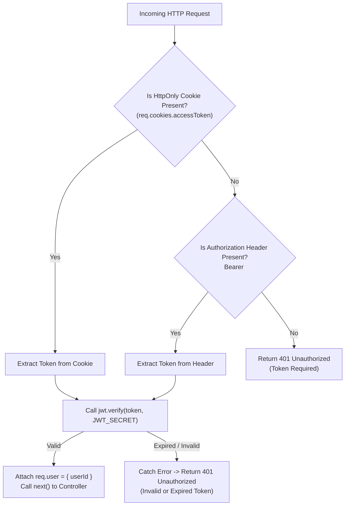
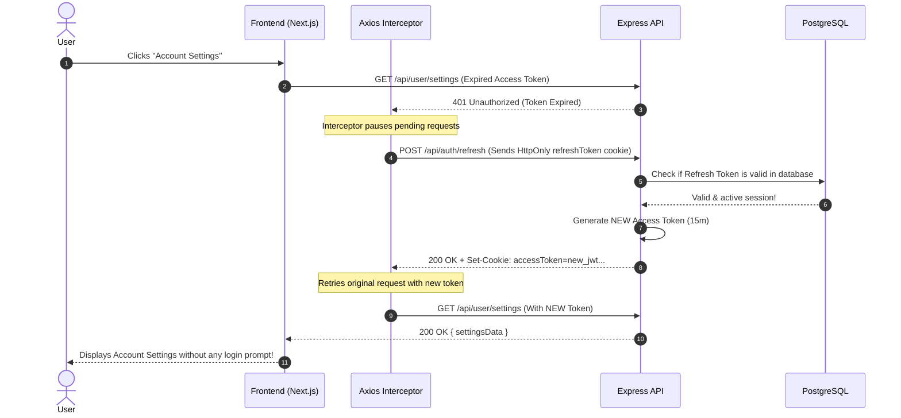

# 🎓 JWT Authentication Master Interview Guide

> **An Exhaustive, Step-by-Step Technical Guide for Full-Stack & Backend Interviews**
> 
> Topics Covered: Token Generation, Cryptographic Signing, HttpOnly Cookie Storage, Expiration Handling, Refresh Token Rotation, Middleware Verification, and Top 10 System Design Interview Questions.

---

## 📑 Table of Contents
1. [The 30-Second Elevator Pitch (Interview Summary)](#1-the-30-second-elevator-pitch)
2. [Anatomy of a JWT (Header, Payload, Signature)](#2-anatomy-of-a-jwt)
3. [Phase 1: Token Generation on Login](#3-phase-1-token-generation-on-login)
4. [Phase 2: Token Storage Strategies (Cookies vs LocalStorage)](#4-phase-2-token-storage-strategies)
5. [Phase 3: Request Verification via Middleware](#5-phase-3-request-verification-via-middleware)
6. [Phase 4: What Happens When a Token Expires?](#6-phase-4-what-happens-when-a-token-expires)
7. [Phase 5: Refresh Tokens Deep Dive (The Silent Refresh Flow)](#7-phase-5-refresh-tokens-deep-dive)
8. [Phase 6: Logout & Session Invalidation](#8-phase-6-logout--session-invalidation)
9. [Complete End-to-End Visual Sequence Diagram](#9-complete-end-to-end-visual-sequence-diagram)
10. [Top 10 System Design & JWT Interview Questions & Answers](#10-top-10-interview-questions--answers)

---

## 1. The 30-Second Elevator Pitch

> *"A JSON Web Token (JWT) is a compact, URL-safe, self-contained standard (RFC 7519) used to securely transmit claims between a client and a server.*
> 
> *In our architecture, when a user logs in, the server verifies their credentials with **Bcrypt**, cryptographically signs a JWT containing the user's ID using a secret key (**HMAC-SHA256**), and sets it inside an **HttpOnly, Secure, SameSite Cookie**.*
> 
> *On subsequent requests, the browser automatically transmits the cookie. Our Express **`authenticateJWT` middleware** verifies the token signature without querying the database for session lookups, allowing stateless and horizontally scalable authentication."*

---

## 2. Anatomy of a JWT

A JWT string is composed of **three Base64URL-encoded parts** separated by dots (`.`):

```text
eyJhbGciOiJIUzI1NiIsInR5cCI6IkpXVCJ9.eyJ1c2VySWQiOiJkZGUyNGZjMy...In0.s7Gz8kH9w0xYZ...
└───────────────┬──────────────────┘ └─────────────────┬────────────────┘ └───────────┬──────────┘
           1. HEADER                             2. PAYLOAD                       3. SIGNATURE
```

### 1. Header (Algorithm & Token Type)
Tells the server which algorithm was used to sign the token:
```json
{
  "alg": "HS256",
  "typ": "JWT"
}
```

### 2. Payload (Claims & User Data)
Contains identity claims and timestamps:
```json
{
  "userId": "dde24fc3-e03d-4e97-aaa6-6a5cb86510a8",
  "iat": 1727891234,  // Issued At timestamp
  "exp": 1727894834   // Expiration timestamp (iat + 1 hour)
}
```
> ⚠️ **Critical Interview Note**: The payload is **encoded, NOT encrypted**. Anyone who intercepts the token can decode the payload. Therefore, **never store passwords, credit cards, or API secrets inside a JWT payload**.

### 3. Signature (Cryptographic Integrity Seal)
Calculated by hashing the Base64 Header and Payload with the server's private `JWT_SECRET`:
$$\text{Signature} = \text{HMAC-SHA256}(\text{Base64Url}(\text{Header}) + "." + \text{Base64Url}(\text{Payload}), \textbf{JWT\_SECRET})$$

If a malicious actor modifies `userId` in the payload, the signature calculation will fail because only the server knows the `JWT_SECRET`.

---

## 3. Phase 1: Token Generation on Login

### Step-by-Step Code Execution Flow:

1. **User submits credentials** (`POST /api/auth/login` with `{ email, password }`).
2. **Input Validation**: Server parses payload with **Zod** schema.
3. **Database Lookup**: Server queries PostgreSQL via Prisma to find user by email.
4. **Password Verification**: `bcrypt.compare(password, user.passwordHash)` checks hash validity in constant time to prevent timing attacks.
5. **Token Signing**:
   ```typescript
   // backend/src/services/auth.service.ts
   const token = jwt.sign(
     { userId: user.id },      // Claims
     ENV.JWT_SECRET,           // Secret Signing Key
     { expiresIn: '1h' }       // Expiry Window
   );
   ```
6. **Cookie Dispatch**: The controller attaches the cookie to the HTTP response header:
   ```typescript
   // backend/src/controllers/auth.controller.ts
   res.cookie('accessToken', token, {
     httpOnly: true,  // Blocks JavaScript access (XSS immune)
     secure: process.env.NODE_ENV === 'production', // HTTPS only
     sameSite: 'lax', // CSRF protection
     maxAge: 3600000, // 1 Hour lifespan
     path: '/',
   });
   ```

---

## 4. Phase 2: Token Storage Strategies

| Storage Mechanism | XSS Vulnerability | CSRF Vulnerability | Interview Assessment |
| :--- | :--- | :--- | :--- |
| **`localStorage` / `sessionStorage`** | ❌ **High Risk**: Any injected JS script can read `localStorage.getItem('token')` and exfiltrate it. | ✅ Immune | **Not Recommended** for sensitive web production apps. |
| **`HttpOnly Cookie`** *(Our Architecture)* | ✅ **Immune**: Browser blocks client-side JavaScript from accessing `document.cookie`. | ⚠️ Requires `SameSite: 'Lax'` or CSRF tokens. | 🏆 **Industry Best Practice** for Web SPAs & Next.js. |
| **In-Memory (JS Variable / React State)** | ✅ Immune to persistent XSS. | ✅ Immune | ⚠️ Token is lost on page refresh unless paired with Silent Refresh. |

---

## 5. Phase 3: Request Verification via Middleware

When the client requests a protected endpoint (e.g. `GET /api/auth/me` or `/api/dashboard`):



---

## 6. Phase 4: What Happens When a Token Expires?

1. **Server Detection**: `jwt.verify(token, JWT_SECRET)` checks the `exp` claim against the server's current timestamp (`Date.now() / 1000`).
2. **Server Reaction**: If `Date.now() > exp`, `jsonwebtoken` throws a `TokenExpiredError`.
3. **401 Response**: The middleware immediately intercepts the error and returns:
   ```json
   HTTP/1.1 401 Unauthorized
   {
     "success": false,
     "message": "Unauthorized: Invalid or expired token"
   }
   ```
4. **Client-Side Guard**: The frontend's `<ProtectedRoute>` component receives the `401`, clears user state in `AuthContext`, and redirects the user to `/login`.

---

## 7. Phase 5: Refresh Tokens Deep Dive

### ❓ Why Short-Lived Access Tokens + Long-Lived Refresh Tokens?
- If an **Access Token** lasts 30 days and gets intercepted, the attacker has 30 days of access.
- By making the **Access Token expire in 15 minutes** and the **Refresh Token expire in 7 days**, we minimize the exposure window while keeping the user logged in seamlessly.

### 🔄 The Silent Refresh Flow



---

## 8. Phase 6: Logout & Session Invalidation

### Why Logout with Stateless JWTs is Tricky:
Because JWTs are **stateless**, the server does not hold a session record. Even if the user clicks logout, the token remains mathematically valid until its `exp` time arrives!

### Production Solutions:
1. **Client Cookie Invalidation (Implemented)**:
   The server issues `res.clearCookie('accessToken')`, removing the cookie from the user's browser.
2. **Refresh Token Revocation in Database**:
   Delete the user's `refreshToken` row from PostgreSQL so no new access tokens can be minted.
3. **Redis Token Blacklist (For high-security banking apps)**:
   Store logged-out `jti` (JWT Token IDs) in an in-memory Redis cache with a TTL equal to the token's remaining lifespan.

---

## 9. Complete End-to-End Visual Sequence Diagram

```mermaid
sequenceDiagram
    autonumber
    actor User
    participant Browser as Browser Cookie Vault
    participant Frontend as Next.js Frontend
    participant Server as Express Backend
    participant DB as PostgreSQL (Supabase)

    %% 1. REGISTRATION
    Note over User,DB: Phase 1: Registration
    User->>Frontend: Fill name, email, password
    Frontend->>Server: POST /api/auth/register
    Server->>Server: Hash password with Bcrypt (Salt 10)
    Server->>DB: INSERT into "users" table
    DB-->>Server: User record created
    Server-->>Frontend: 201 Created { success: true }

    %% 2. LOGIN & TOKEN ISSUANCE
    Note over User,DB: Phase 2: Login & JWT Creation
    User->>Frontend: Enter credentials
    Frontend->>Server: POST /api/auth/login
    Server->>DB: SELECT * FROM "users" WHERE email = ?
    DB-->>Server: User data with passwordHash
    Server->>Server: bcrypt.compare(password, passwordHash) == true
    Server->>Server: jwt.sign({ userId }, JWT_SECRET, { expiresIn: '1h' })
    Server->>Browser: Set-Cookie: accessToken=eyJ...; HttpOnly; Secure; SameSite=Lax
    Server-->>Frontend: 200 OK { success: true, user }

    %% 3. AUTHENTICATED REQUEST
    Note over User,DB: Phase 3: Authenticated Request
    User->>Frontend: Visits /dashboard
    Frontend->>Browser: Request /api/auth/me (withCredentials: true)
    Browser->>Server: GET /api/auth/me + Cookie: accessToken=eyJ...
    Server->>Server: jwt.verify(token, JWT_SECRET) -> Valid!
    Server->>DB: SELECT id, name, email FROM "users" WHERE id = userId
    DB-->>Server: User profile
    Server-->>Frontend: 200 OK { user }
    Frontend-->>User: Render protected dashboard

    %% 4. LOGOUT
    Note over User,DB: Phase 4: Logout
    User->>Frontend: Click "Logout"
    Frontend->>Server: POST /api/auth/logout
    Server->>Browser: Set-Cookie: accessToken=; Max-Age=0 (Wiped)
    Server-->>Frontend: 200 OK { message: "Logged out" }
    Frontend-->>User: Redirect to /login
```

---

## 10. Top 10 Interview Questions & Answers

### Q1: Is a JWT encrypted or encoded?
> **Answer**: By default, standard JWTs (JWS) are **Base64URL-encoded and cryptographically signed**, NOT encrypted. Anyone can decode the payload at `jwt.io`. If sensitive encryption is required, JWE (JSON Web Encryption) is used.

### Q2: How do you revoke or invalidate a JWT before it expires?
> **Answer**: Since JWTs are stateless, you can revoke them using 3 techniques:
> 1. **Short Lifespan + Refresh Tokens**: Keep access token lifespan at 10-15 minutes and delete the Refresh Token from the DB on logout.
> 2. **Redis Blacklist**: Store revoked token IDs (`jti`) in Redis with a TTL equal to the token's remaining time.
> 3. **Token Versioning / Password Changed Timestamp**: Store a `tokenVersion` or `passwordChangedAt` in the DB and embed it in the JWT; if the DB version is higher, reject the token.

### Q3: What is the difference between Symmetric (HS256) and Asymmetric (RS256) signing?
> **Answer**: 
> - **HS256 (Symmetric)**: Uses a single shared secret key for both signing and verification. Best for monolithic apps.
> - **RS256 (Asymmetric)**: Uses a **Private Key** (kept secure on Auth Server) to sign tokens, and a **Public Key** distributed to microservices to verify tokens without sharing the signing secret.

### Q4: Why use Bcrypt with 10 salt rounds instead of SHA-256 or MD5 for passwords?
> **Answer**: SHA-256 and MD5 are fast general-purpose hashing algorithms. Attackers with GPUs can test billions of SHA-256 hashes per second using rainbow tables. **Bcrypt is an adaptive key derivation function** with a configurable work factor (salt rounds) specifically engineered to be CPU- and memory-intensive, making brute-force attacks computationally infeasible.

### Q5: How does HttpOnly Cookie protect against XSS attacks?
> **Answer**: Cross-Site Scripting (XSS) occurs when malicious JavaScript runs in the browser. When a cookie has the `HttpOnly` flag, the browser blocks `document.cookie` access from JavaScript, ensuring an attacker cannot steal the token via script injection.

### Q6: What is CSRF and how does `SameSite=Lax` prevent it?
> **Answer**: Cross-Site Request Forgery (CSRF) tricks a user's browser into sending authenticated requests to a target site where they are logged in. Setting `SameSite: 'Lax'` tells the browser to **never send the cookie on cross-site subrequests (e.g. images, AJAX, forms)**, effectively eliminating CSRF vulnerability.

### Q7: What is Refresh Token Rotation?
> **Answer**: Every time a client uses a Refresh Token to get a new Access Token, the server invalidates the old Refresh Token and issues a **brand new Refresh Token**. If a stolen refresh token is used twice, the server detects token reuse and immediately revokes all active sessions for that user.

### Q8: How does JWT enable Horizontal Scaling?
> **Answer**: In traditional session-based auth, servers must store session IDs in memory or query a shared database (like Redis) on every request. With JWT, any server instance with the `JWT_SECRET` can verify the token mathematically in-memory **without network or database lookups**, allowing effortless horizontal auto-scaling.

### Q9: Where in the request can a JWT be passed?
> **Answer**: 
> 1. In an **`HttpOnly` Cookie** (Standard for Web browsers).
> 2. In the **`Authorization` HTTP Header**: `Bearer <token>` (Standard for Mobile apps, Postman, and Microservices).

### Q10: How do you handle multi-device login tracking with JWT?
> **Answer**: Create a `sessions` or `refresh_tokens` table in PostgreSQL storing `userId`, `deviceInfo`, `ipAddress`, `refreshTokenHash`, and `createdAt`. When a user reviews active devices in their settings, they can individually revoke specific device tokens.
